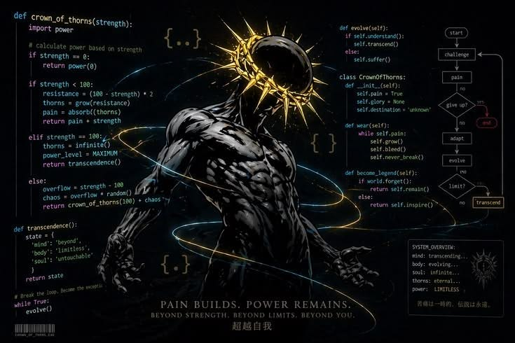

  

<h1 align="center">⚡ Mahan Amini ⚡</h1>

<h3 align="center">Backend Engineer · Python Craftsman · System Builder</h3>

  

  <i>I don't just write code — I design systems that survive real traffic.</i>

 

<h2 align="center">🧬 About Me</h2>

<!--
  GitHub strips CSS and media queries from READMEs, so a "switch layout under 768px" rule isn't possible.
  Instead the image sits in its own centered row above the text, which looks right on every screen size.
-->

  

**Shaddy** here — a final-year Computer Engineering student who lives in the backend.

I love turning messy requirements into clean, production-ready APIs with **Python**, and I'm obsessed with understanding how real-world systems actually work under the hood: from the database query to the packet on the wire.

🔭 **Currently levelling up:** FastAPI · PostgreSQL · SQLAlchemy · Docker · Redis
🧩 **Sharpening the blade:** Data Structures & Algorithms
🎯 **The mission:** write code that's clean, build software that's reliable, and grow into an engineer whose systems outlast their deadlines.

 

<h2 align="center">🤝 Connect</h2>

  
  &nbsp;&nbsp;&nbsp;
  
  &nbsp;&nbsp;&nbsp;
  
  &nbsp;&nbsp;&nbsp;
  

 

<h2 align="center">🛠️ Arsenal</h2>

  

 

<h2 align="center">📊 GitHub Stats</h2>

  

<h3 align="center">⌘ Commit Activity</h3>

  

 

  <i>"Make it work, make it right, make it fast."</i> 🚀

